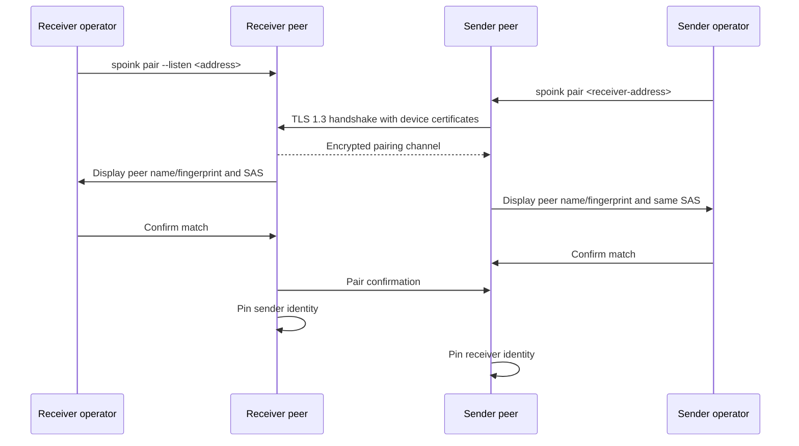
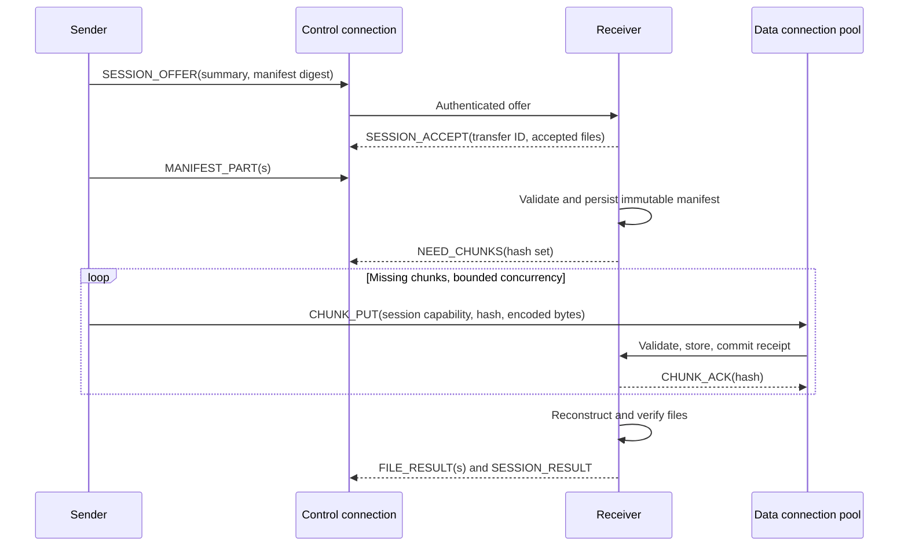

# Use Cases and User Flows

> Status: Approved  
> Actors: Sender operator, receiver operator, sender peer, receiver peer.

## UC-001 — Initialize and pair two devices

**Preconditions:** Spoink is installed. Devices are on a reachable local network. Users can see both terminals.

**Failure behavior:** Mismatched codes, user rejection, timeout, certificate/handshake error, or dropped connection creates no trusted record. Repeating pairing with an already pinned but changed identity requires explicit revocation/re-pairing.

## UC-002 — Send multiple files directly

**Preconditions:** Devices are paired. Receiver is listening with an approved destination root.

1. Receiver runs `spoink receive --dest <root> --listen <address>`.
2. Sender runs `spoink send <receiver-address> <file-or-directory>...`.
3. Sender enumerates regular files, normalizes relative paths, chunks/hashes them, and constructs an immutable manifest.
4. Peers authenticate using pinned device identities.
5. Receiver displays peer, file count, logical bytes, destination paths, and overwrite request.
6. Receiver accepts all or an explicit subset.
7. Receiver reserves paths and reports verified chunks already held locally.
8. Sender transfers missing chunks over bounded data connections.
9. Receiver validates and durably acknowledges chunks.
10. Receiver reconstructs, verifies, and atomically finalizes each file.
11. Both sides print the same transfer ID and compatible final status; exit codes reflect local outcome.

## UC-003 — Delta re-transfer

The sender offers content whose chunks partly overlap receiver-held verified chunks. The receiver computes the missing set from chunk hashes and requests only those payloads. Existing chunks are never trusted solely from an unverified filename or previous manifest; they must exist in the verified content store.

**Acceptance evidence:** Telemetry shows logical bytes, reused bytes, and chunk payload bytes. Protocol overhead is reported separately where measured.

## UC-004 — Resume after interruption

1. A session is accepted and transfers some chunks.
2. Network or process interruption occurs.
3. The receiver restarts and reconciles temporary/store/database state.
4. The same paired sender reconnects with the transfer ID and manifest digest.
5. Receiver authenticates the peer and either resumes or returns a stable incompatibility reason.
6. A new session capability is issued for new data connections.
7. Receiver reports only chunks not durably verified.
8. Transfer, reconstruction, and finalization continue.

Resume is refused when the peer identity, manifest digest, CDC profile, accepted path set, or incompatible protocol major version differs.

## UC-005 — Existing destination

- Without explicit overwrite, the receiver rejects that file before payload transfer.
- With overwrite, the original remains visible until the replacement is fully reconstructed and verified.
- If replacement fails before atomic rename, the original remains unchanged.
- A batch can complete other accepted files; final status becomes partial if any accepted file fails.

## UC-006 — Corrupt or malformed input

The receiver rejects malformed frames before allocating unbounded memory. A chunk with wrong decoded length or SHA-256 receives a non-retryable data-integrity NACK for that attempt. The sender MAY retry a bounded number of times; repeated deterministic mismatch fails the file/session and raises security/integrity telemetry.

## UC-007 — Reverse direction on a later transfer

There is no permanent upload/download role. To send files in the reverse direction, the former sender starts `receive` and the former receiver starts `send`. Automatic reconciliation of changes made independently on both devices is outside v1.

## UC-008 — Revoke a device

The operator lists paired devices, revokes the selected fingerprint, and confirms. New and resumed sessions from it are rejected. Existing received files and unrelated peer records remain. Re-pairing is a new explicit trust ceremony.

## UC-009 — Store maintenance

The operator runs inspection before GC. The tool reports referenced, leased, unreferenced, temporary, and corrupt data. Dry-run shows candidates. Actual GC deletes only data proven unreferenced and not leased, and remains recoverable after interruption.
