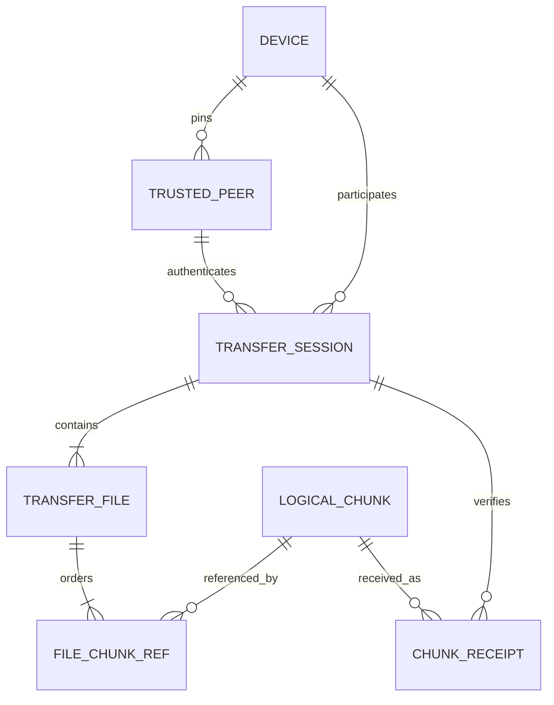
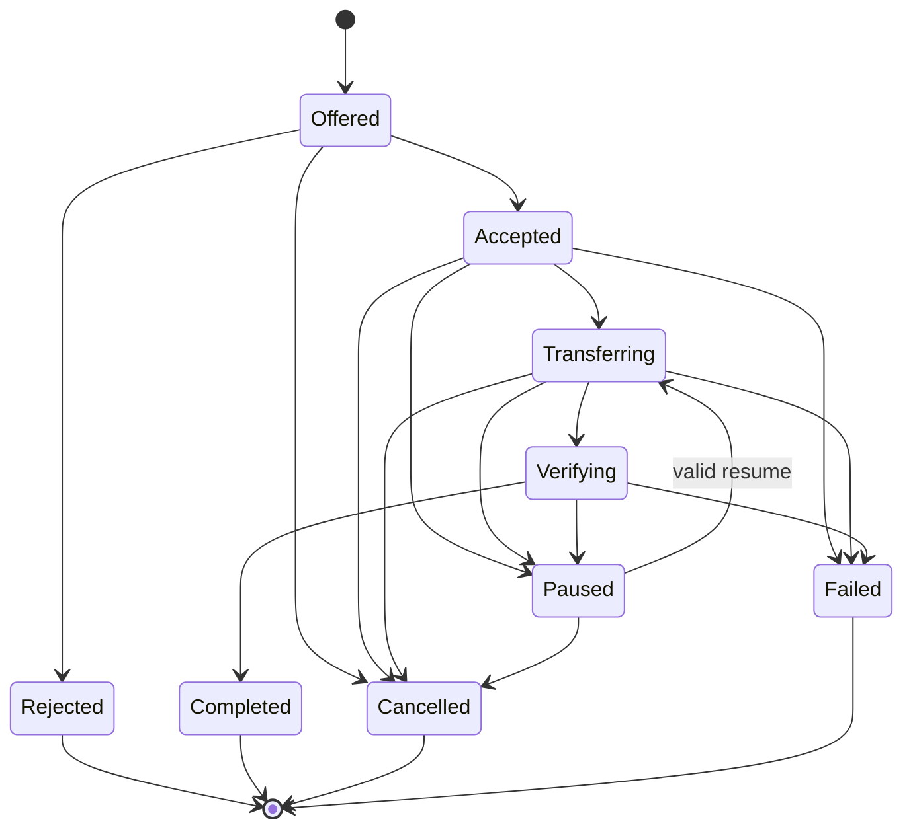

# Domain Model and Glossary

> Status: Approved

## Core model

## Terms

| Term | Definition |
|---|---|
| Device | One DeltaSync installation with a persistent local identity and store. |
| Peer | Another device as seen by the local device. |
| Paired peer | A peer whose public-key identity was confirmed through the pairing ceremony and pinned locally. |
| Peer ID | SHA-256 fingerprint of the canonical DER SubjectPublicKeyInfo for a device identity key. It is represented as lowercase hexadecimal at contract boundaries. |
| Sender | The device offering file content in one transfer session. This is a temporary role. |
| Receiver | The device accepting and reconstructing content in one transfer session. This is a temporary role, not a permanent server. |
| Transfer session | One immutable accepted manifest exchanged between one sender and receiver, identified by a receiver-issued transfer ID. |
| Transfer file | One accepted regular file within a session, named by a normalized relative path. |
| Manifest | Canonical description of the session's files, sizes, whole-file hashes, ordered chunk references, and chunking profile. |
| Manifest digest | SHA-256 of the canonical manifest serialization. It binds resume and acceptance to identical content and paths. |
| CDC profile | Versioned set of parameters that fully determines Rabin content-defined chunk boundaries. |
| Logical chunk | Immutable plaintext byte range produced by CDC and identified by SHA-256. It is independent of compression and transport connection. |
| Encoded chunk | A transient wire representation of a logical chunk: raw, LZ4, or Zstd plus declared plaintext length. It is not the content identity. |
| Transport frame | A bounded protocol unit carried over one TLS connection. A logical chunk may be framed according to the wire contract without changing its identity. |
| Content store | Receiver-local filesystem holding verified plaintext logical chunks under content-derived names. |
| Chunk receipt | Durable statement that a particular session can rely on a verified chunk in the local store. |
| Reuse/deduplication | Referencing an already verified local chunk instead of sending or storing another payload. |
| Staging file | Incomplete reconstructed output that is never exposed as a completed destination. |
| Finalization | Whole-file verification followed by atomic rename/replacement into the destination. |
| Control connection | TLS connection carrying negotiation, manifests, progress, errors, resume, and session results. |
| Data connection | TLS connection carrying chunk payload frames for one authenticated session. |
| Session capability | Receiver-generated random secret, delivered on the control connection, that binds data connections to one active session. It is not a long-term identity. |
| SAS | Short authentication string displayed on both devices during first pairing. Users confirm that the strings match. |
| Logical bytes | Sum of original file sizes accepted for a session. |
| Useful bytes | Plaintext bytes of chunks the receiver did not already possess and successfully accepted. |
| Wire bytes | Bytes attributable to DeltaSync frames and payload, with transport/TLS overhead included only when the measurement method can observe it. |
| Reused bytes | Logical chunk bytes satisfied from the receiver's verified local store. |

## Invariants

1. A transfer session has exactly one sender, one receiver, one accepted manifest digest, and one protocol major version.
2. Sender and receiver roles may reverse only in a different session.
3. Logical chunk identity is SHA-256 of plaintext bytes; compression never changes identity.
4. A manifest's chunk references cover each file from offset zero to exact declared size without gaps or overlap.
5. An accepted manifest and CDC profile are immutable.
6. A chunk is “verified” only after decoded length and SHA-256 match and durable storage completes.
7. ACK implies the receiver can recover the verified chunk after a supported crash.
8. A completed file has passed whole-file size and SHA-256 verification.
9. A final destination never names an incomplete staging file.
10. Normal sessions require a pinned, non-revoked peer ID.
11. A data connection belongs to one transfer session and the same paired identity as its control connection.
12. Adaptive scheduling cannot modify manifests, logical chunks, hashes, or correctness decisions.
13. Store deletion is conservative: uncertain reference/lease state prevents deletion.

## Transfer-session state

- `Paused` is resumable under retention policy.
- `Failed` is non-resumable unless an error explicitly returns a resumable state.
- Overall `Completed` requires all accepted files completed. Otherwise the terminal result is `Failed`, `Cancelled`, or a partial result represented by completed file rows plus a non-completed session state.

## File state

`Pending → Transferring → Reconstructing → Verifying → Completed`

From any non-terminal state, a file may become `Paused`, `Failed`, or `Cancelled`. A rejected offered file is `Rejected` and is not part of accepted logical bytes.

## Domain rules

- Empty files are valid and have an empty chunk list plus the SHA-256 digest of empty input.
- Duplicate content across files may reuse chunks, but file paths and whole-file hashes remain independent.
- Relative paths use `/` in the manifest. The receiver converts them only after validation.
- Case-colliding paths on a case-insensitive target are a pre-transfer error. Linux v1 still detects exact duplicates.
- Compression metadata belongs to a transfer attempt, not the persistent logical manifest.
- Receiver approval applies to the exact offered manifest summary and destination policy.
