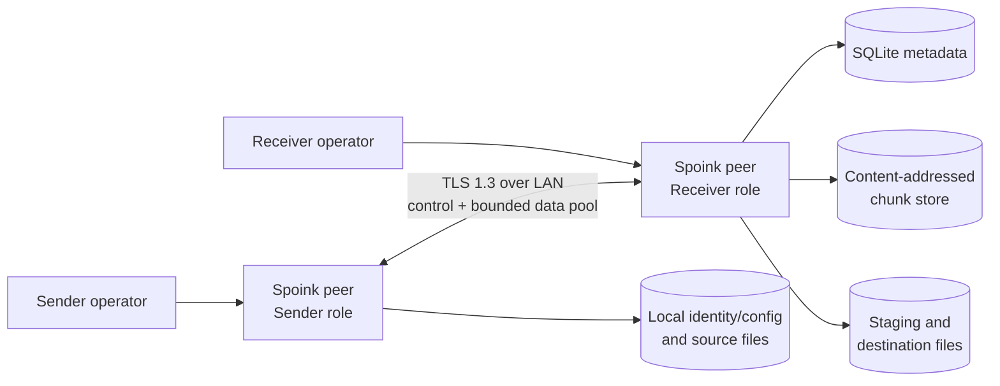

# System Overview

> Status: Approved  
> Decisions: ADR-001 through ADR-006

## Context



There is no permanent server. The receiving peer listens only when requested. Both installations contain the same capabilities; role selection changes the active components and write ownership.

## Component map

| ID | Component | Responsibility | Must not own |
|---|---|---|---|
| ARCH-01 | Identity and trust | Generate local identity; perform SAS pairing; pin/revoke peers; configure TLS verification. | File authorization, manifests, or transfer policy. |
| ARCH-02 | Session controller | Negotiate offers, acceptance, transfer IDs/capabilities, state transitions, resume, and terminal results. | Raw file parsing, cryptography implementation, or chunk storage details. |
| ARCH-03 | Selection and manifest | Enumerate inputs, normalize relative paths, compute canonical immutable manifests, and validate incoming manifests. | Destination writes or network scheduling. |
| ARCH-04 | Chunking and delta | Produce deterministic Rabin CDC chunks/hashes; compare manifest hashes to verified local inventory. | Network-dependent boundary changes. |
| ARCH-05 | Compression router | Negotiate representations; estimate benefit; encode/decode raw/LZ4/Zstd with size limits. | Logical identity or persistent compressed storage. |
| ARCH-06 | Transport and scheduler | TLS connections, framing, bounded queues, idempotent submissions, signals, connection/in-flight adaptation, retries. | Deciding that corrupt data is valid or mutating manifests. |
| ARCH-07 | Store and reconstruction | Install verified chunk blobs, persist references/receipts, reconstruct staging files, verify whole files, atomically finalize. | Peer trust decisions or source enumeration. |
| ARCH-08 | Recovery coordinator | Reconcile DB/filesystem after startup, resume matching sessions, and classify orphan/inconsistent state. | Deleting uncertain data automatically. |
| ARCH-09 | Lifecycle and GC | Retention, leases, reference-safe cleanup, store inspection, quarantine. | Active session scheduling or implicit destination deletion. |
| ARCH-10 | CLI and telemetry | Validate commands/config, render prompts/progress/results, structured logs/metrics, benchmark export. | Core state transitions based on presentation behavior. |

## Primary data flow

```text
selected files
  → normalized file set
  → Rabin CDC logical chunks
  → plaintext SHA-256 identities + whole-file SHA-256
  → canonical immutable manifest
  → receiver inventory/delta response
  → optional raw/LZ4/Zstd wire representation
  → bounded TLS data pool
  → decode + length/hash verification
  → durable local chunk store + receipt
  → staged file reconstruction
  → whole-file verification
  → atomic finalization
```

The receiver is authoritative for acceptance, missing-chunk selection, durable ACKs, and finalization. The sender is authoritative for the offered source snapshot and manifest. Neither side may silently rewrite the accepted manifest.

## Deployment view

V1 is two Linux processes on mutually reachable devices. Each process links or dynamically loads approved OpenSSL, SQLite, LZ4, and Zstd versions. It requires no daemon, cloud resource, message broker, external database, or DNS service. The receiver listens on an explicitly configured interface/port and writes only below configured state, store, staging, and destination roots.

Default deployment is interactive foreground execution. A system service is allowed later if it preserves explicit peer/destination allow rules and secret permissions.

## Trust boundaries

1. CLI input and configuration are untrusted until parsed/validated.
2. Source filesystem entries may change during manifesting/transfer and must be checked for snapshot consistency.
3. Every network byte is untrusted even after TLS; TLS authenticates a device, not correctness.
4. Compressed input is untrusted and bounded before decompression.
5. SQLite and chunk-store inconsistencies are possible after crashes or external modification.
6. Final destination paths must remain contained despite manifest input and filesystem races.

## Backpressure and ownership

- Pipeline stages communicate through bounded queues measured in items and bytes.
- File readers own source buffers until hashing/encoding completes.
- A wire buffer is immutable while a data connection writes it.
- Receiver verification owns decoded bytes until store commit or rejection.
- SQLite connections are not shared concurrently unless the wrapper/library mode explicitly permits it; transactions are short.
- Global resource arbitration enforces per-session and per-device limits so several sessions cannot each consume the full device budget.

## External dependencies

| Dependency | Purpose | Architectural constraint |
|---|---|---|
| OpenSSL-compatible library | TLS 1.3, certificate/key operations, SHA-256, CSPRNG, TLS exporter | No custom cryptographic primitives. Exact supported release selected in operations/CI. |
| SQLite | Transactional local metadata and migrations | WAL mode; foreign keys enabled; busy handling bounded. |
| LZ4 | Fast lossless encoding | Optional advertised capability; decoded length bounded. |
| Zstd | Higher-ratio lossless encoding | Optional advertised capability; decoded length bounded. |

Terminal rendering and JSON/serialization helper libraries are implementation choices unless they affect a public schema or license policy.

## Architecture rules

- No unauthenticated normal-transfer path.
- No unbounded count, length, queue, retry, or connection value from configuration or network input.
- No final-file visibility before verification.
- No ACK before durable chunk/receipt semantics are satisfied.
- No scheduler action changes correctness state.
- No performance claim without benchmark evidence.
