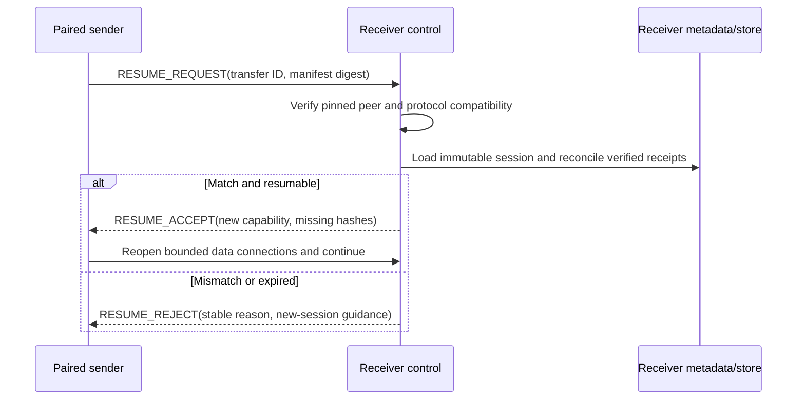

# Components and Runtime Flows

> Status: Approved

## Process structure

One `spoink` executable selects a command role. The implementation MAY use an event loop, threads, or both, but MUST preserve these logical executors:

- control executor: ordered session state and protocol decisions;
- filesystem/hash workers: bounded source read, CDC, digest, and reconstruction work;
- compression workers: bounded encode/decode work;
- data-connection workers: network reads/writes and frame validation;
- persistence executor/pool: serialized short SQLite writes plus safe reads;
- telemetry sink: non-blocking bounded event handling.

Implementation thread count is configurable. No component assumes one OS thread per logical component.

## Sender flow

1. **Selection:** `ARCH-03` resolves inputs relative to declared roots, rejects unsupported/duplicate paths, and records stable file identity metadata used to detect source mutation.
2. **Manifesting:** `ARCH-04` streams each file through CDC and SHA-256. `ARCH-03` canonicalizes the manifest and computes its digest.
3. **Authentication:** `ARCH-01/06` establishes mTLS and verifies the pinned receiver peer ID.
4. **Offer:** `ARCH-02` sends summary and manifest digest; content does not transfer before acceptance.
5. **Manifest transfer:** full canonical manifest is sent with bounded parts and validated by receiver.
6. **Delta:** receiver reports required chunk hashes; sender validates every request belongs to the accepted manifest.
7. **Pipeline:** source bytes are reread or retained according to bounded caching; mutation checks ensure the bytes still match declared hashes. `ARCH-05` chooses a negotiated representation.
8. **Scheduling:** `ARCH-06` fairly schedules missing chunks across the data pool and retries only allowed failures.
9. **Completion:** sender consumes durable ACKs and file/session results and writes a stable local result report.

If a source file changes after manifest creation, the sender stops that file with `SOURCE_CHANGED`; it does not send bytes under stale hashes.

## Receiver flow

1. **Listen/authenticate:** accept only configured address/port, enforce handshake timeouts/limits, and map the TLS key to a pinned peer.
2. **Offer validation:** bound file count/logical size/manifest size, validate path summaries, storage availability, and operator approval.
3. **Manifest persistence:** receive all parts, validate canonical digest/invariants, create immutable session/file/reference rows transactionally.
4. **Need set:** join manifest chunk references against verified store state; return exact missing hashes.
5. **Data intake:** bind every data connection to peer/session/capability; bound frames and decompression; hash plaintext.
6. **Durable commit:** write/flush/rename new blob if absent, commit metadata/receipt, then ACK. Existing valid blob follows an idempotent metadata path.
7. **Reconstruction:** once every file reference resolves, stream chunks in ordinal order to a same-filesystem staging file.
8. **Verification/finalization:** flush, compare size/digest, atomically rename or replace per policy, persist completed state, then report success.

## Resume flow



Resume never trusts sender-reported progress over receiver durable state.

## Commit ordering for a new chunk

1. Receive into a bounded temporary file/buffer.
2. Decode with exact maximum output equal to declared logical chunk length.
3. Verify plaintext SHA-256 and length.
4. If canonical blob already exists, verify its metadata and skip blob installation.
5. Otherwise write a store-local temporary blob, flush it, atomically rename to canonical path, and persist directory metadata as required by the Linux durability model.
6. In a short SQLite transaction, upsert verified chunk metadata and the session receipt/reference state.
7. Commit transaction.
8. Send ACK.

Crash before step 8 may cause a safe duplicate retry. Startup reconciliation handles a blob without DB row and a DB row with missing blob; the latter is never treated as verified.

## Concurrency rules

- Session state mutations are serialized through `ARCH-02` or compare-and-swap transactions.
- Two incoming attempts for the same hash may race; only one canonical rename wins, and both verify the resulting blob before receipt commit.
- Destination path reservation prevents simultaneous sessions from finalizing the same relative path. The later conflicting offer is rejected or waits only if an explicit future policy permits it; v1 rejects.
- A chunk under reconstruction holds a read lease visible to GC.
- Closing a data connection does not imply session failure; the retry classifier decides.
- Control loss stops scheduling new work. No new capability is accepted after it expires or is replaced during resume.

## Failure boundaries

| Boundary | Failure result |
|---|---|
| Identity/TLS | Reject connection; security event; no application parsing. |
| Offer/manifest | Stable protocol rejection; no payload acceptance. |
| Source scan/chunk | Fail affected file/session before or during transfer; never substitute changed bytes. |
| Compression | Retry raw only if source chunk remains verified and peer supports raw; otherwise fail attempt. |
| Data connection | Retry idempotent unacknowledged chunks within budget; session may pause. |
| Store/disk | Stop ACKs immediately; classify capacity versus I/O/corruption; preserve evidence. |
| Reconstruction | Fail file, retain resumable chunks per policy, do not finalize. |
| Telemetry sink | Drop/count low-priority telemetry under pressure; never block correctness indefinitely. |

## Implementation module targets

```text
src/
├── cli/          command parsing and presentation
├── identity/     keys, certificates, peer pins, pairing
├── protocol/     schemas, framing, validation, state machine
├── transport/    TLS sockets, control/data connections
├── session/      offer, acceptance, resume, terminal state
├── manifest/     paths, canonical form, validation
├── chunking/     Rabin CDC and hashing
├── compression/  entropy estimation, LZ4, Zstd
├── scheduler/    signals, policy, fair work queue
├── store/        SQLite repositories, chunk blobs, GC
├── reconstruct/  staging, whole-file verification, finalization
├── telemetry/    events, metrics, reports
└── support/      bounded buffers, errors, config, utilities
```

This layout is guidance, not an architectural law. Contract ownership and dependency direction are normative.
